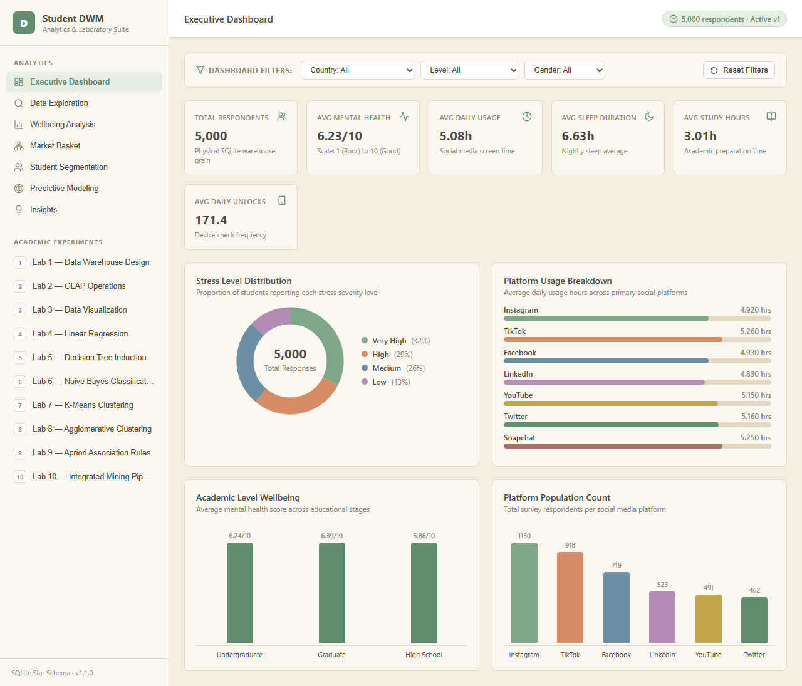
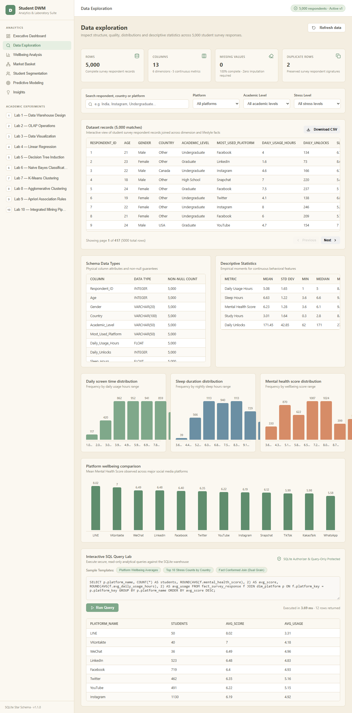
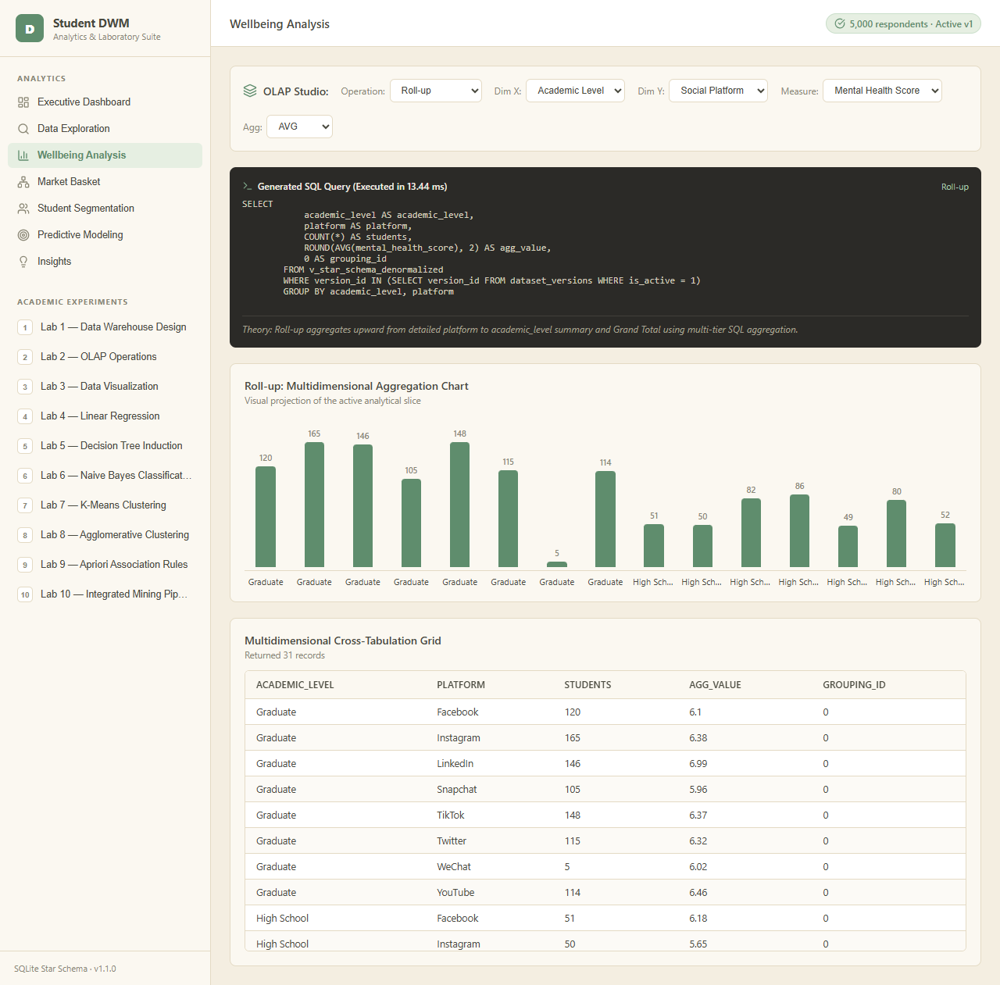
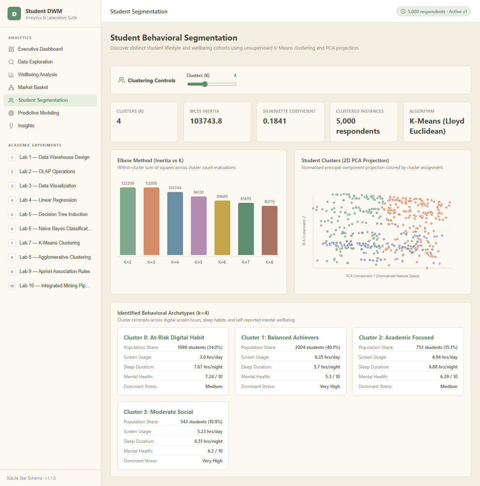
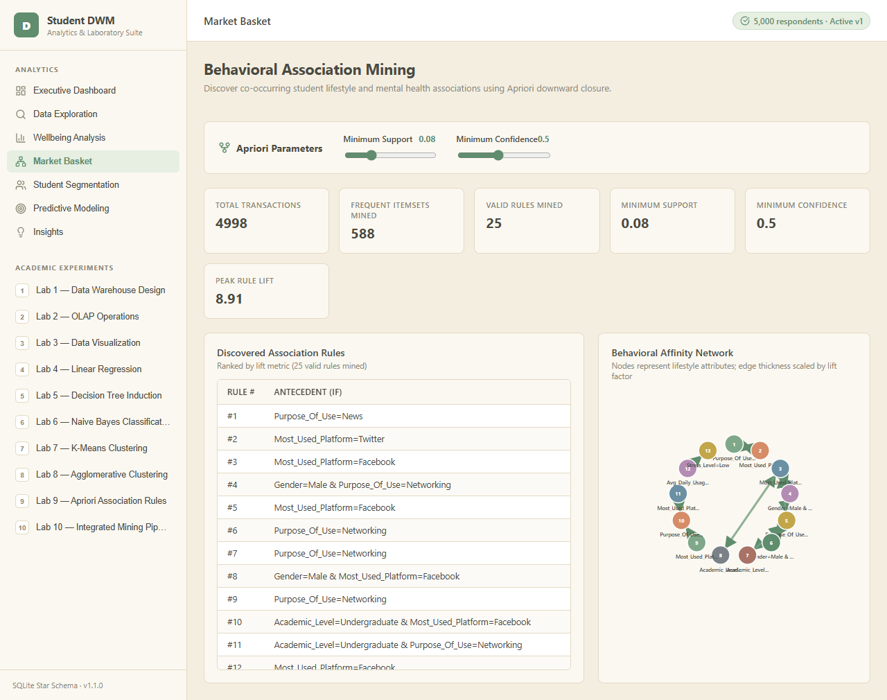
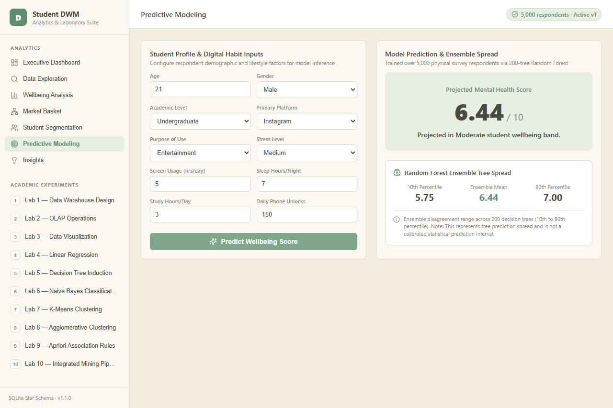
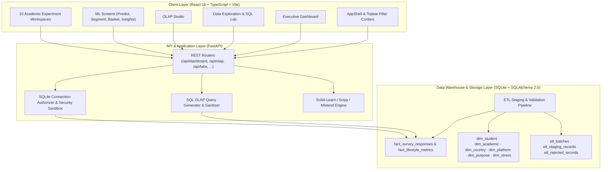

# MindScope — Student Wellbeing Analytics & DWM Platform

[](https://www.python.org/downloads/)
[](https://fastapi.tiangolo.com)
[](https://react.dev/)
[](https://www.typescriptlang.org/)
[](https://vitejs.dev/)
[](https://www.sqlalchemy.org/)
[](https://creativecommons.org/licenses/by/4.0/)

> **MindScope** is an enterprise-grade dimensional data warehouse, SQL-backed OLAP engine, and interactive Data Mining platform built to analyze behavioral digital habits, lifestyle factors, and student mental health patterns across 5,000 real respondent records.

---

## 🌟 Executive Overview

MindScope bridges the gap between academic data warehousing theory and real-world analytical software engineering. It implements an end-to-end, reproducible Data Warehouse and Data Mining (DWM) architecture featuring:

- **Relational Dimensional Modeling:** Persistent SQLite warehouse with Star, Snowflake, and Fact-Constellation schemas with strict foreign key constraints.
- **Two-Phase ETL Staging Pipeline:** Robust ingestion with source lineage preservation, reject logging, validation rules, and atomic activation.
- **SQL-Backed OLAP Engine:** Dynamic multidimensional query generation supporting `ROLL-UP`, `DRILL-DOWN`, `SLICE`, `DICE`, `PIVOT`, and `CUBE` operations.
- **Sandboxed Interactive SQL Lab:** Read-only analytical SQL query workbench protected by SQLite low-level authorizer callbacks, statement timeouts, and row clamping.
- **Integrated Machine Learning & Data Mining Suite:** Production-grade Scikit-learn, Scipy, and Mlxtend algorithms for predictive modeling, clustering, and association rules.
- **Modern Responsive React SPA:** Polished UI with synchronized global filtering, SVG charts, and interactive algorithm runners.

---

## 📸 Platform Tour & Screenshots

| Executive Dashboard | Data Exploration & SQL Query Lab |
|:---:|:---:|
|  |  |
| *Synchronized cross-filtering, distribution charts, and cohort KPIs* | *Multi-dimensional search, distribution stats, and sandboxed SQL Lab* |

| OLAP Studio & Multidimensional Analysis | Student Segmentation & 2D PCA |
|:---:|:---:|
|  |  |
| *Dynamic cube slices, roll-up grouping sets, and heatmaps* | *K-Means clustering with 2D PCA projection and inertia curves* |

| Market Basket Association Network | Predictive Modeling & Uncertainty |
|:---:|:---:|
|  |  |
| *Apriori high-lift behavioral rule mining with affinity graph* | *Linear regression, decision trees, and ensemble uncertainty* |

---

## 🏛 System Architecture & Dimensional Model

### Architecture Diagram



### Dimensional Warehouse Schemas
- **Star Schema:** Operational schema centered around `fact_survey_responses` (5,000 grains) with de-normalized foreign key dimensions: `dim_student`, `dim_academic`, `dim_country`, `dim_platform`, `dim_purpose`, and `dim_stress`.
- **Snowflake Schema:** Educational normalized schema splitting dimension hierarchies (e.g., `dim_country` → `dim_region`, `dim_academic` → `dim_degree_level`).
- **Fact Constellation:** Shared dimensional cross-analysis connecting `fact_survey_responses` and `fact_lifestyle_metrics` across shared academic, geographic, and platform dimensions.

---

## 🔬 The 10 Academic DWM Practical Labs

MindScope natively implements the complete 10-experiment Data Warehousing and Data Mining practical curriculum:

| Lab | Practical Title | Analytical Technique | Key Controls & Interactive Capabilities |
|:---:|---|---|---|
| **01** | **Data Warehouse Design** | Dimensional Modeling | Interactive schema explorer for Star, Snowflake, and Constellation designs with SQL DDL inspection. |
| **02** | **OLAP Operations** | Multidimensional SQL OLAP | Real-time `ROLL-UP`, `DRILL-DOWN`, `SLICE`, `DICE`, `PIVOT`, and `CUBE` with dynamic SQL translation. |
| **03** | **Data Visualization & EDA** | Visual Encodings & Variance | Bar, scatter, and box distributions with attribute cross-tabulation and variance analysis. |
| **04** | **Linear Regression** | Ordinary Least Squares (OLS) | Dynamic train/test split slider, feature selection, $R^2$ / MSE scoring, and residual plots. |
| **05** | **Decision Tree Induction** | Information Gain / Entropy | Configurable max-depth tree generator with interactive SVG hierarchy and split rules. |
| **06** | **Naive Bayes Classification** | Gaussian / Categorical Bayes | Probabilistic stress classification with prior/posterior tables and interactive confusion matrix. |
| **07** | **K-Means Clustering** | Unsupervised Centroid Clustering | Configurable $k$ (2–8), WCSS elbow curve calculation, 2D PCA projection, and cluster centroid profiles. |
| **08** | **Agglomerative Clustering** | Hierarchical Clustering | Complete full-cohort ($N=4,998$) dendrogram visualization, Ward/Complete/Average linkage, and ARI scoring. |
| **09** | **Apriori Association Rules** | Frequent Itemset Mining | Support, confidence, and lift thresholds with high-confidence tabular rules and force-directed graph. |
| **10** | **Integrated Mining Pipeline** | Multi-Stage Workflow | End-to-end WEKA-style stepper: Discretization → Model Evaluation → Clustering → Association Rules. |

---

## 🛠 Tech Stack

### Backend
- **Python 3.12**
- **FastAPI**: Asynchronous high-performance REST API.
- **SQLAlchemy 2.0**: Modern declarative ORM and parameterized SQL execution.
- **SQLite 3**: WAL mode, foreign key enforcement, and read-only authorizer security sandboxing.
- **Scikit-learn & Scipy**: Machine learning models, hierarchical dendrograms, PCA transformations.
- **Mlxtend**: Association rule generation and frequent itemset extraction.
- **Pandas & NumPy**: High-performance vectorized numerical transformations.

### Frontend
- **React 18 & TypeScript**: Strongly-typed component architecture.
- **Vite 6**: Instant hot module replacement and optimized production bundler.
- **Tailwind CSS & Lucide Icons**: Consistent, responsive modern design system.
- **Pure SVG & Procedural Visualizations**: Responsive, lightweight chart components and network graphs.

---

## 🚀 Quick Start Guide

### Prerequisites
- Python 3.12 or higher
- Node.js 18+ and npm
- `uv` (recommended) or standard `pip`

### 1. Clone the Repository
```bash
git clone https://github.com/Ayushpatil15/mindscope-dwm.git
cd mindscope-dwm
```

### 2. Backend Setup
```bash
# Using uv (fastest)
uv sync

# Or using standard pip
python -m venv .venv
source .venv/bin/activate  # On Windows: .venv\Scripts\activate
pip install -e .
```

### 3. Initialize the Warehouse
Verify and populate the SQLite warehouse from the source survey data:
```bash
uv run python backend/scripts/init_warehouse.py
```

### 4. Frontend Setup & Build
```bash
cd frontend
npm install
npm run build
cd ..
```

### 5. Launch Application
Start the Uvicorn server (FastAPI serves both the API and the compiled React frontend):
```bash
uv run uvicorn backend.main:app --host 127.0.0.1 --port 8000 --reload
```
Open your browser and navigate to:
```
http://127.0.0.1:8000
```

---

## 🧪 Testing & Verification

MindScope comes with comprehensive automated verification suites covering backend endpoints, database integrity, and end-to-end browser flows:

### Backend Unit & Integration Tests (40 Tests)
```bash
uv run python -m pytest backend/tests/ -v
```

### Frontend Production Build Verification
```bash
cd frontend
npm run build
```

### End-to-End Browser Tests (Playwright - 13 Tests)
```bash
cd frontend
npx playwright test
```

---

## 📊 Dataset & Privacy

The analytical platform operates on the **Student Social Media & Mental Health Impact** dataset (5,000 respondent records).

- **Source:** Created by Shiva Singh, published on Kaggle.
- **License:** [Creative Commons Attribution 4.0 International (CC BY 4.0)](https://creativecommons.org/licenses/by/4.0/).
- **Privacy & Anonymity:** Fully anonymized survey data. Contains **zero** Personally Identifiable Information (no student names, emails, phone numbers, student IDs, or institution names). All attributes are aggregate behavioral and lifestyle metrics.

---

## 📄 License

This project is licensed under the MIT License — see the codebase for details. The underlying dataset is shared under the CC BY 4.0 license.
